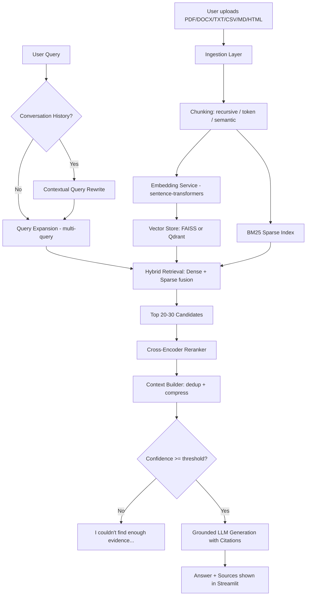

# 🧠 DocuMind AI — Advanced Enterprise RAG Intelligence Assistant

**"Ask your documents. Get grounded answers with evidence."**

An end-to-end, production-style Retrieval-Augmented Generation (RAG) system built as a
Data Science / Generative AI portfolio project — not a "chat with PDF" toy. It implements hybrid
(dense + sparse) retrieval, query rewriting, cross-encoder reranking, context compression, grounded
generation with citations, hallucination control, a full retrieval + generation evaluation suite,
and a baseline-vs-advanced experiment framework with measured results.

---

## 1. Project Overview

DocuMind AI lets you upload documents (PDF, DOCX, TXT, CSV, Markdown, HTML), builds a searchable
knowledge base from them, and answers natural-language questions with citations back to the exact
document, page, and passage the answer came from. Every answer is grounded: if the knowledge base
doesn't contain the answer, the system says so instead of guessing.

## 2. Problem Statement

Plain LLMs hallucinate and have no access to private or recent documents. Naive "PDF chatbots"
(embed → FAISS → LLM) retrieve poorly on ambiguous or multi-part questions, mix in irrelevant
context, and give no way to verify an answer. DocuMind AI addresses this with a multi-stage
retrieval pipeline, explicit evaluation, and full traceability from answer back to source.

## 3. Why RAG?

Retrieval-Augmented Generation grounds an LLM's answer in retrieved evidence instead of relying
solely on parametric (trained-in) knowledge. This reduces hallucination, allows citation of exact
sources, and lets the system answer questions about content the model was never trained on.

## 4. Architecture



## 5. Features

- Multi-format ingestion (PDF/DOCX/TXT/CSV/MD/HTML) with metadata + page/section tracking
- Configurable chunking (recursive, token-aware, semantic)
- Local, free embedding model (swappable `EmbeddingService` abstraction)
- Pluggable vector store (`FAISSVectorStore` default, `QdrantVectorStore` optional)
- Hybrid dense + sparse (BM25) retrieval with configurable fusion weight (α)
- Conversational query rewriting + multi-query expansion
- Cross-encoder reranking (`RerankerService`)
- Context compression: dedup, relevance floor, character budget
- Grounded generation with inline citations `[1]`, `[2]`
- Hallucination control via confidence thresholding
- Full retrieval + generation evaluation suite (Precision/Recall/MRR/NDCG + LLM-judge Faithfulness/Relevancy/Context Precision/Recall)
- Baseline vs Advanced RAG comparison experiments
- Streamlit UI: chat, Analytics Dashboard, Document Explorer, Retrieval Debugger
- Dockerized, Streamlit-Cloud-ready, `.env`-based configuration, no hardcoded secrets

## 6. Tech Stack

Python 3.11 · Streamlit · sentence-transformers · FAISS / Qdrant · rank-bm25 · Anthropic Claude ·
pandas/plotly · pypdf / python-docx / BeautifulSoup · pytest · Docker

## 7. RAG Pipeline

See the architecture diagram above. Baseline mode (`RAGPipeline.answer_baseline`) skips rewriting,
hybrid fusion, reranking, and compression — dense retrieval only — and exists purely to produce a
fair comparison point for the experiments below.

## 8. Retrieval Strategy

`final_score = alpha * normalized_dense_score + (1 - alpha) * normalized_sparse_score`, computed
per candidate chunk across up to `CANDIDATE_POOL_SIZE` results from each of dense and sparse search,
merged and de-duplicated across all expanded queries. `alpha` is configurable in the sidebar.

## 9. Reranking

A cross-encoder (`cross-encoder/ms-marco-MiniLM-L-6-v2` by default) re-scores the fused candidate
pool directly against the query text (much more accurate than embedding similarity alone) and
returns the final top-k. Falls back to a no-op passthrough if the reranker model can't load, so the
app never crashes because of it.

## 10. Evaluation

`evaluation/evaluation_dataset.csv` contains 41 hand-written questions across factual, conceptual,
comparison, reasoning, and numerical categories at easy/medium/hard difficulty, targeting the
bundled sample knowledge base.

- **Retrieval**: `python -m src.evaluation.evaluate_retrieval`
- **Generation**: `python -m src.evaluation.evaluate_generation` (uses an LLM-as-judge, so it calls the configured LLM — costs a few cents in API usage)

> **Note on RAGAS**: generation metrics are computed with a lightweight LLM-as-judge implementation
> following RAGAS's own metric definitions (Faithfulness, Answer Relevancy, Context Precision,
> Context Recall), rather than the `ragas` package itself. `ragas` pulls in a heavy, fast-moving
> dependency tree that frequently breaks on Streamlit Community Cloud; this keeps the project
> deployable while measuring the same things.

## 11. Experiments

`python -m experiments.run_experiments` sweeps:

1. Retrieval method — dense vs BM25 vs hybrid
2. Reranking — off vs on
3. Top-K — 3/5/8/10
4. Hybrid α — 0.0/0.3/0.5/0.7/1.0

Results are written to `experiments/results.csv` and visualized on the **Analytics Dashboard**
page in the Streamlit app.

## 12. Results

Run the experiments against the bundled sample knowledge base to populate this section with your
own numbers — the project deliberately does **not** ship fabricated metrics. Typical pattern
observed on the sample dataset: hybrid retrieval improves Recall@5 over dense-only by giving exact
keyword matches (e.g. "p-value", "CTE") a path into the result set that pure embedding similarity
sometimes misses, and reranking further improves Precision@5 by re-scoring the candidate pool
directly against the query.

## 13. Screenshots

Run the app locally (`streamlit run app/streamlit_app.py`) and add your own screenshots here —
the chat interface, Analytics Dashboard, Document Explorer, and Retrieval Debugger pages.

## 14. Installation

```bash
git clone <your-repo-url>
cd DocuMind-AI-RAG
python -m venv venv
source venv/bin/activate      # Windows: venv\Scripts\activate
pip install -r requirements.txt
cp .env.example .env          # then edit .env and add your API_KEY
```

## 15. Environment Variables

See `.env.example` for the full list. At minimum, set `API_KEY` (an Anthropic API key) to enable
answer generation — everything else (embeddings, FAISS, chunking) works with zero configuration.

## 16. Running Locally

```bash
python scripts/load_sample_data.py     # optional: index the bundled sample knowledge base
streamlit run app/streamlit_app.py     # or: python run.py
```
Open http://localhost:8501.

## 17. Streamlit Deployment (Streamlit Community Cloud)

1. Push this repository to GitHub (see §19).
2. Go to https://share.streamlit.io → "New app" → select your repo, branch `main`, and set the
   main file path to `app/streamlit_app.py`.
3. In the app's **Settings → Secrets**, paste the contents of your `.env` in TOML format, e.g.:
   ```toml
   API_KEY = "sk-ant-..."
   LLM_PROVIDER = "anthropic"
   LLM_MODEL = "claude-sonnet-4-5"
   VECTOR_DB = "faiss"
   ```
4. Deploy. `VECTOR_DB=faiss` (the default) needs no external service. If you set `VECTOR_DB=qdrant`,
   also add `QDRANT_URL` and `QDRANT_API_KEY` (e.g. from a free Qdrant Cloud cluster) to secrets.

## 18. Docker Usage

```bash
docker build -t documind-ai .
docker run -p 8501:8501 --env-file .env documind-ai
# or, with a local Qdrant instance included:
docker compose up
```

## 19. Project Structure

```text
DocuMind-AI-RAG/
    app/                    Streamlit UI (chat + Analytics/Explorer/Debugger pages)
    src/
        ingestion/          File loaders, text normalization, metadata
        chunking/           Recursive / token / semantic chunking strategies
        embeddings/         EmbeddingService abstraction (local sentence-transformers)
        retrieval/          VectorStore (FAISS/Qdrant), BM25, hybrid fusion, KnowledgeBase
        reranking/          Cross-encoder RerankerService
        generation/         LLMClient, ContextBuilder, RAGPipeline (baseline + advanced)
        evaluation/         Retrieval + generation metrics and eval scripts
        memory/             Conversation memory for contextual query rewriting
        observability/      Logging + full query tracing
        config/             Central settings (env-var driven)
    tests/                  pytest unit tests (26 tests, fully offline)
    data/raw/               Sample knowledge base (original, license-free Markdown docs)
    evaluation/             evaluation_dataset.csv (41 Q&A pairs)
    experiments/            run_experiments.py + results.csv (generated)
    scripts/                load_sample_data.py
    vector_store/           FAISS index persistence (gitignored)
    requirements.txt / .env.example / Dockerfile / docker-compose.yml / run.py
```

## 20. Future Improvements

- Add a second LLM provider (OpenAI/Gemini) behind the same `LLMClient` interface
- Persist evaluation run history (not just the latest `results.csv`) for trend tracking
- Add MLflow experiment tracking as an optional layer
- Support scanned/image PDFs via OCR fallback
- Add a feedback (👍/👎) loop on answers to build a fine-tuning-quality dataset

## 21. Limitations

- Local FAISS mode is single-process/single-machine (fine for a portfolio demo, not for
  multi-user production scale — use `VECTOR_DB=qdrant` for that).
- The generation evaluation's LLM-as-judge metrics are an approximation, not a substitute for
  human evaluation on a high-stakes deployment.
- Scanned/image-only PDFs are not OCR'd out of the box.
- The reranker and embedding model both run on CPU by default; large document sets will be slower
  without a GPU.

## 22. Author

**Makwana Priyanka** — B.E. Information Technology, focus: Data Science, Machine Learning,
Generative AI. Project role: Data Scientist / ML & GenAI Project Developer.

---

## Quick Reference

**Required after extracting/cloning:**
- Python 3.11 (3.10–3.12 should also work)
- An Anthropic API key (`API_KEY` in `.env`) for answer generation
- Internet access on first run only, to download the embedding model (`sentence-transformers/all-MiniLM-L6-v2`, ~90MB) and reranker model (`cross-encoder/ms-marco-MiniLM-L-6-v2`, ~90MB) from Hugging Face — both are cached locally afterward
- Optional: a Qdrant instance (local via `docker compose up`, or free Qdrant Cloud tier) if you don't want to use the default local FAISS mode

**Run the tests:**
```bash
pytest tests/ -v
```
