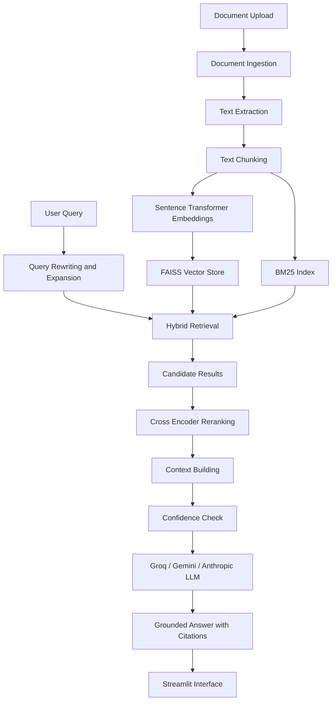

# 🧠 DocuMind AI — Advanced RAG Intelligence Assistant

**Ask your documents. Get grounded answers with evidence.**

DocuMind AI is an advanced Retrieval-Augmented Generation (RAG) application that allows users to upload documents, search their content, and receive context-aware answers powered by Large Language Models (LLMs).

Built with Python, Streamlit, Sentence Transformers, FAISS, BM25, and Groq AI, this project demonstrates an end-to-end RAG architecture with hybrid retrieval, reranking, grounded generation, source citations, and evaluation capabilities.

> An AI-powered document intelligence system designed to make information retrieval more accurate, transparent, and efficient.

---

## 🚀 Project Overview

Traditional LLMs may generate inaccurate answers or hallucinate information because they do not automatically have access to a user's private documents.

DocuMind AI addresses this challenge through Retrieval-Augmented Generation.

Users can upload documents, build a searchable knowledge base, and ask natural-language questions. The system retrieves relevant document chunks and uses the configured LLM to generate answers grounded in the retrieved context.

If sufficient supporting evidence is unavailable, the system can avoid generating unsupported answers through its confidence-based grounding mechanism.

## ✨ Key Features

### 1. Multi-Format Document Ingestion
- Upload PDF, DOCX, TXT, CSV, Markdown, and HTML files.
- Extract text and document metadata.
- Preserve page and section information where available.
- Automatically split documents into manageable chunks.

### 2. Intelligent Chunking
- Recursive chunking.
- Configurable chunk size and overlap.
- Structured document segmentation.

### 3. Semantic Embeddings
- Sentence Transformers integration.
- Default embedding model: `sentence-transformers/all-MiniLM-L6-v2`.
- Local embedding generation without a paid embedding API.

### 4. Hybrid Retrieval
- Dense retrieval using FAISS vector search.
- Sparse retrieval using BM25.
- Hybrid score fusion.
- Configurable retrieval parameters.

### 5. Query Processing
- Query rewriting.
- Multi-query expansion.
- Conversational context support.

### 6. Cross-Encoder Reranking
- Relevance-based candidate reranking.
- Default model: `cross-encoder/ms-marco-MiniLM-L-6-v2`.
- Improved ranking of retrieved document chunks.

### 7. Grounded AI Generation
- Groq AI integration.
- Gemini AI integration.
- Anthropic provider support through the LLM client.
- Context-aware answer generation.
- Source-based citations.
- Confidence thresholding to reduce unsupported answers.

### 8. Premium Streamlit Interface
- Modern dark-themed interface.
- Interactive document question-answering experience.
- Analytics Dashboard.
- Document Explorer.
- Retrieval Debugger.
- Retrieval and generation performance insights.

### 9. Evaluation & Experimentation
- Retrieval evaluation.
- Generation evaluation.
- Precision, Recall, MRR, and NDCG metrics.
- Faithfulness and answer relevance evaluation.
- Baseline vs. Advanced RAG experiments.

---

## 🏗️ System Architecture



## 🛠️ Technology Stack

| Category | Technologies |
|---|---|
| Programming Language | Python 3.11 |
| Frontend / UI | Streamlit |
| LLM Integration | Groq, Google Gemini, Anthropic |
| Embeddings | Sentence Transformers |
| Vector Database | FAISS, Qdrant (optional) |
| Sparse Retrieval | BM25 |
| Reranking | Cross-Encoder |
| Data Processing | Pandas, NumPy |
| Visualization | Plotly |
| Document Processing | PyPDF, python-docx, BeautifulSoup |
| Testing | Pytest |
| Deployment | Streamlit Community Cloud |
| Containerization | Docker |

---

## 📂 Project Structure

```text
DocuMind-AI-RAG/
│
├── app/
│   ├── streamlit_app.py
│   ├── state.py
│   └── pages/
│       ├── 1_Analytics_Dashboard.py
│       ├── 2_Document_Explorer.py
│       └── 3_Retrieval_Debugger.py
│
├── src/
│   ├── ingestion/
│   ├── chunking/
│   ├── embeddings/
│   ├── retrieval/
│   ├── reranking/
│   ├── generation/
│   ├── evaluation/
│   ├── memory/
│   ├── observability/
│   ├── config/
│   └── utils/
│
├── data/
│   ├── raw/
│   └── processed/
│
├── evaluation/
│   └── evaluation_dataset.csv
│
├── experiments/
│   └── run_experiments.py
│
├── scripts/
│   └── load_sample_data.py
│
├── tests/
│
├── vector_store/
│
├── .env.example
├── .gitignore
├── Dockerfile
├── docker-compose.yml
├── requirements.txt
├── run.py
└── README.md
```

---

## ⚙️ Installation & Setup

### Prerequisites

- Python 3.11 recommended.
- Git.
- Groq API key (for Groq generation).
- Internet connection for downloading embedding and reranking models on first use.

### 1. Clone the Repository

```bash
git clone https://github.com/priii-236/DocuMind-AI-RAG.git

cd DocuMind-AI-RAG
```

### 2. Create a Virtual Environment

**Windows:**

```powershell
python -m venv .venv

.venv\Scripts\activate
```

**Linux / macOS:**

```bash
python -m venv .venv

source .venv/bin/activate
```

### 3. Install Dependencies

```bash
pip install -r requirements.txt
```

### 4. Configure Environment Variables

Create a `.env` file from the example:

**Windows:**

```powershell
Copy-Item .env.example .env
```

**Linux / macOS:**

```bash
cp .env.example .env
```

Open `.env` and configure your LLM provider.

Example Groq configuration:

```env
LLM_PROVIDER=groq
LLM_MODEL=openai/gpt-oss-20b
API_KEY=your_groq_api_key_here
```

Use a model ID that is currently available to your Groq account. Model availability and rate limits depend on your account and the selected model.

You can generate an API key through:

https://console.groq.com/keys

**Security:** Never upload your actual `.env` file or API keys to GitHub.

---

## ▶️ Run the Application Locally

Start the Streamlit application:

```bash
streamlit run app/streamlit_app.py
```

Alternatively:

```bash
python run.py
```

Open your browser at:

```text
http://localhost:8501
```

### Load Sample Data

To load the bundled sample knowledge base:

```bash
python scripts/load_sample_data.py
```

---

## 📊 Application Modules

### 1. Main Chat Interface

- Upload documents.
- Ask questions about indexed documents.
- Receive AI-generated answers.
- View supporting sources and citations.
- Configure retrieval and generation settings.

### 2. Analytics Dashboard

- Knowledge base statistics.
- Query activity analytics.
- Retrieval performance.
- Latency and confidence insights.
- Baseline vs. Advanced RAG experiment comparisons.

### 3. Document Explorer

- Browse indexed documents.
- Inspect document metadata.
- Explore individual text chunks.
- Search document content using BM25.

### 4. Retrieval Debugger

- Inspect original and rewritten queries.
- View dense retrieval results.
- View sparse BM25 results.
- Inspect merged and reranked results.
- Explore final context passed to the LLM.
- Analyze answer confidence and latency.

---

## 🧪 Evaluation

The project includes an evaluation dataset containing 41 hand-written questions covering different question types and difficulty levels.

### Retrieval Evaluation

```bash
python -m src.evaluation.evaluate_retrieval
```

Metrics include:

- Precision
- Recall
- Mean Reciprocal Rank (MRR)
- Normalized Discounted Cumulative Gain (NDCG)

### Generation Evaluation

```bash
python -m src.evaluation.evaluate_generation
```

Generation evaluation uses an LLM-as-judge approach to assess:

- Faithfulness
- Answer Relevancy
- Context Precision
- Context Recall

**Note:** Generation evaluation calls the configured LLM and may incur API usage costs.

---

## 🔬 RAG Experiments

Run the experiment framework:

```bash
python -m experiments.run_experiments
```

Experiments explore:

1. Dense vs. Sparse vs. Hybrid Retrieval.
2. Reranking enabled vs. disabled.
3. Different Top-K values.
4. Different Hybrid Alpha values.

Results are written to:

```text
experiments/results.csv
```

The Analytics Dashboard can visualize available experiment results.

**Note:** Performance metrics should be generated through actual experiment runs. No fabricated benchmark results are reported in this repository.

---

## ☁️ Streamlit Community Cloud Deployment

DocuMind AI can be deployed using Streamlit Community Cloud.

### Deployment Steps

1. Push the project repository to GitHub.
2. Visit https://share.streamlit.io/
3. Sign in using GitHub.
4. Select **Create app**.
5. Choose the repository:

   `priii-236/DocuMind-AI-RAG`

6. Select branch:

   `main`

7. Set the main file path:

   `app/streamlit_app.py`

8. Open **Advanced settings → Secrets**.
9. Add your environment configuration in TOML format.

Example:

```toml
LLM_PROVIDER = "groq"
LLM_MODEL = "openai/gpt-oss-20b"
API_KEY = "your_groq_api_key_here"
VECTOR_DB = "faiss"
```

10. Click **Deploy**.

**Important deployment considerations:**

- Never expose API keys in source code or GitHub.
- Configure secrets through Streamlit Community Cloud.
- Local vector-store files are not included in the Git repository.
- The knowledge base may need to be initialized again after deployment.
- Embedding and reranking models require memory and startup time.
- Cloud resource limits may affect performance with larger documents.

---

## 🐳 Docker Deployment

Build the Docker image:

```bash
docker build -t documind-ai .
```

Run the application:

```bash
docker run -p 8501:8501 --env-file .env documind-ai
```

Alternatively, use Docker Compose:

```bash
docker compose up
```

---

## 🧪 Run Tests

Run the project test suite:

```bash
pytest tests/ -v
```

---

## 🔐 Security

- API keys are stored in environment variables.
- `.env` is excluded through `.gitignore`.
- Streamlit secrets should be configured through the deployment dashboard.
- Never commit credentials, private documents, or sensitive user data.

---

## ⚠️ Limitations

- Local FAISS storage is designed for a single-process demonstration rather than large-scale multi-user production.
- Embedding and reranking models run locally and can require significant memory and startup time.
- Scanned image-only PDFs require an OCR solution, which is not included by default.
- Generation evaluation depends on the configured LLM provider.
- Cloud deployment performance depends on available CPU, RAM, and application resource limits.

---

## 🔮 Future Improvements

- Add OCR support for scanned documents.
- Improve cloud vector database persistence.
- Add document-level access control.
- Introduce user feedback and answer-quality monitoring.
- Add advanced caching and optimized model loading.
- Integrate MLflow for experiment tracking.
- Expand evaluation datasets and benchmark comparisons.

---

## 👩‍💻 Author

**Priyanka Makwana**

B.E. Information Technology  
Focus Areas: Data Science | Machine Learning | Generative AI

- GitHub: https://github.com/priii-236
- LinkedIn: https://www.linkedin.com/in/priyanka-makwana-51128a295

---

## ⭐ Support

If you find this project interesting, consider giving the repository a ⭐ on GitHub!

**Repository:**  
https://github.com/priii-236/DocuMind-AI-RAG

---

*Built with Python, RAG, and Generative AI.* 🧠
